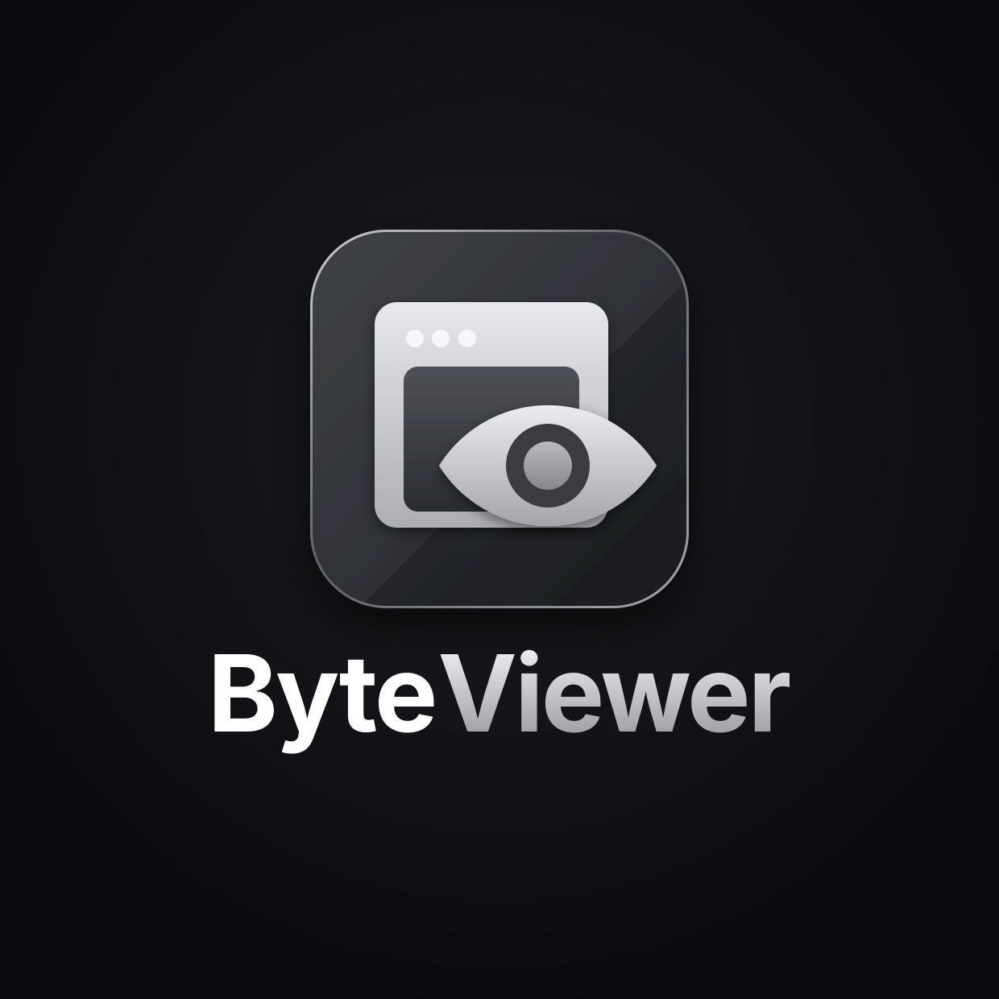

<p align="center">
  
</p>

# ByteViewer

**by ByteKnot Labs**

A tiny iOS app that opens any website as a full-screen app, the way Dodo WebView does.
No browser bars, no tabs, just the page, laid out with the correct viewport and safe areas.

Logo assets live in [`Branding/`](Branding/): the full lockup, the app icon and the standalone mark,
all as SVG. The app icon and launch screen are rendered from them.

## What it does

- Type a URL and open it full screen, or save sites to a list.
- Mark one site as **default** and the app launches straight into it.
- Correct viewport on every device: the web view covers the whole screen and WebKit handles the
  notch and home indicator exactly like Safari does (`viewport-fit=cover` and
  `env(safe-area-inset-*)` work, `100vh` means the real screen height).
- Per-site options: desktop site, hide status bar (also auto-hides the home indicator),
  edge-to-edge, and rotation (Auto / Portrait / Landscape). Rotation is forced through
  `requestGeometryUpdate`, so it works even when the device rotation lock is on.
- Floating `•••` button inside a site: back, forward, reload, rotation, status bar,
  open in Safari, hide controls (three-finger tap brings them back), close.
- Safari user agent so sites serve the same layout they give Safari; cookies and logins persist.
- Pull to refresh, swipe back/forward, inline and full-screen video, `target="_blank"` links,
  JavaScript alerts, `mailto:` / `tel:` links handed to the system.
- **Home-screen launchers**: every site has a `byteviewer://open?site=…` link, a Shortcuts
  action ("Open Site") and an in-app guide for putting it on the Home Screen with its own icon.
  Long-press the app icon for the first four sites.
- **Widget** (small, medium, large) with one-tap shortcuts to your sites.
- **Site icons and theme colour** are fetched automatically; the status bar and safe areas take
  the site's colour.
- Per-site switches: stay in the site (other domains open in Safari), keep screen awake,
  kiosk mode, Face ID / passcode lock, private mode, allow plain `http://`.
- Camera, microphone and location work for sites that ask for them.
- Plain `http://` is upgraded to `https://` unless the site's "Allow plain http://" switch is on.

## Installing the IPA

Every GitHub Release carries `ByteViewer-<version>.ipa`. It is **unsigned**, so it cannot be
installed by tapping it; sign it with your own Apple ID using one of these:

- [Sideloadly](https://sideloadly.io) (Windows or Mac): drag the IPA in, enter your Apple ID, Start.
- [AltStore](https://altstore.io): My Apps, `+`, pick the IPA.
- TrollStore on supported iOS versions installs it without signing.

With a free Apple ID the install expires after 7 days and the tool must refresh it;
a paid developer account removes that limit.

The IPA carries an App Group entitlement that the widget uses to read your site list.
AltStore and Sideloadly register the group with your Apple ID when they sign the app
(the app reads whatever group id they assign from its provisioning profile). If a tool
strips entitlements, the app still works; only the widget shows "Add sites in ByteViewer".

## Building

The GitHub Actions workflow in `.github/workflows/build-ipa.yml` builds an unsigned IPA on a
macOS runner for every push to `main` (download it from the run's artifacts) and publishes a
Release with the IPA attached whenever a tag like `v1.0.0` is pushed:

```bash
git tag v1.0.0 && git push origin v1.0.0
```

To build locally instead, iOS apps need macOS with Xcode. Copy the folder to a Mac and then:

1. Open `ByteViewer.xcodeproj` in Xcode 15 or newer.
2. Select the `ByteViewer` target, then **Signing & Capabilities**: pick your Team and change
   the bundle identifier from `com.example.ByteViewer` to your own.
3. Plug in an iPhone or iPad, choose it as the run destination, and press Run.
   A free Apple ID works for installing on your own device (the build expires after 7 days;
   a paid developer account removes that limit and allows TestFlight / App Store).

Minimum iOS version: 16.0. No third-party dependencies.

## Files

| File | Purpose |
| --- | --- |
| `ByteViewer/ByteViewerApp.swift` | App entry point |
| `ByteViewer/ContentView.swift` | Home screen: quick-open field, saved sites list, add/edit form |
| `ByteViewer/SiteView.swift` | Full-screen site presentation and the floating menu |
| `ByteViewer/WebView.swift` | `WKWebView` wrapper: configuration, viewport handling, delegates |
| `ByteViewer/SiteStore.swift` | `Site` model and UserDefaults persistence |
| `ByteViewer/Orientation.swift` | Orientation lock / forced rotation |

## Notes

- To allow plain `http://` URLs, add an `Info.plist` with an `NSAppTransportSecurity` exception.
- Apple's App Store guideline 4.2 can reject apps that are only a website wrapper. Installing on
  your own devices is not affected.
